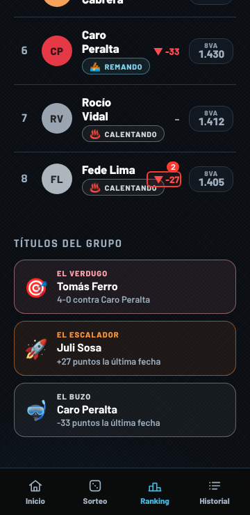
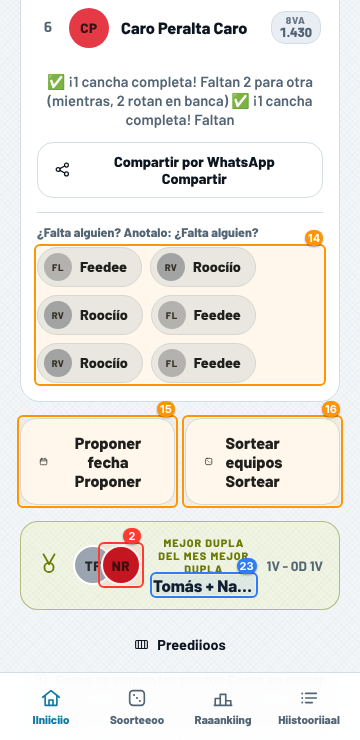
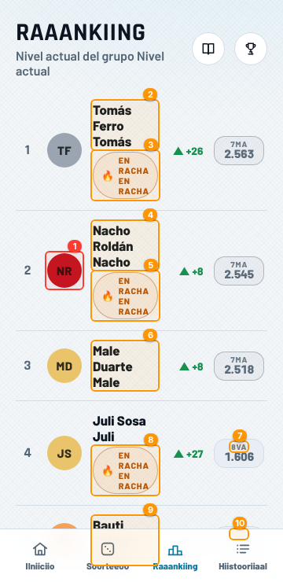
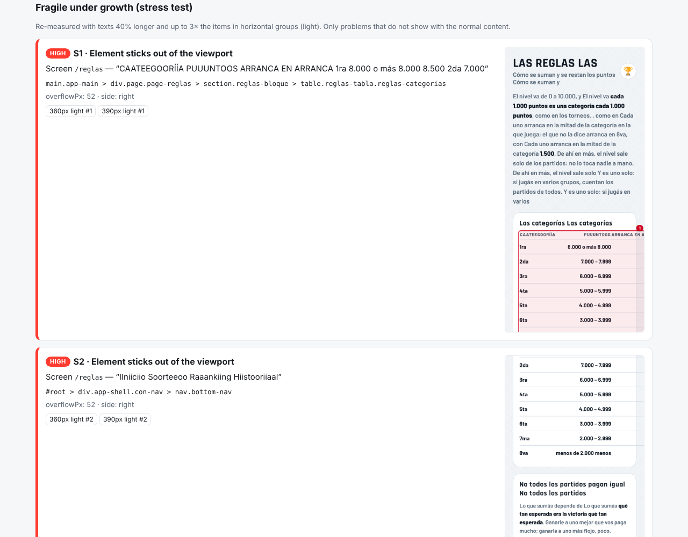

# claude-webapp-qa

Skills de Claude Code para controlar apps web antes de publicarlas: chequeo responsive en varios dispositivos, revisión de UX, tests de reglas de Firestore y releases en un solo PR.

[Read in English](README.md)


## Skills

| Skill | Qué hace | Estado |
|---|---|---|
| [`responsive-check`](skills/responsive-check/SKILL.md) | Levanta tu app y recorre sus pantallas en 360px, 390px y 1280px, modo claro y oscuro, con Playwright. Marca scroll horizontal, elementos que se salen, texto cortado o que desborda, botones que no entran; devuelve capturas marcadas y un reporte por prioridad. | ✅ Lista |
| [`release`](skills/release/SKILL.md) | Junta los cambios en una rama de acumulación, abre un solo PR con resumen, sigue el CI, arregla lo que falla, pasa el link de preview y avisa cuando una imagen pública cambia sin cambiar de nombre (caché). | ✅ Lista |
| `firestore-rules` | Por cada cambio de permisos: la regla, un test que tiene que fallar y otro que tiene que pasar, en el emulador. | 🚧 Planeada |
| `ux-review` | Checklist: íconos con un solo significado y con texto, un solo botón principal según el momento, acciones destructivas protegidas, textos claros. | 🚧 Planeada |
| `i18n-guard` | Textos sin traducir y claves sobrantes. | 🚧 Planeada |
| `pre-push` | Lint/test/build, no subir links simbólicos ni archivos locales, no nombres reales en capturas. | 🚧 Planeada |

## Instalación

En Claude Code:

```
/plugin marketplace add CabralNahuel/claude-webapp-qa
/plugin install webapp-qa@claude-webapp-qa
```

O copiá la carpeta de una skill en `~/.claude/skills/` (personal) o `.claude/skills/` (un proyecto).

## responsive-check

Pedilo como te salga: "fijate cómo se ve en el celu antes de publicar", "en /checkout algo se sale en celulares chicos", "revisá el modo oscuro". Claude va a:

1. Encontrar cómo se levanta la app (`npm run dev`) y qué rutas tiene.
2. Encontrar cómo entrar sin login real (modo demo/sandbox, una clave en localStorage) o usar el que le digas.
3. Correr [`scripts/responsive_check.mjs`](skills/responsive-check/scripts/responsive_check.mjs) en cada ruta × tamaño × tema.
4. Mirar las capturas marcadas, descartar falsas alarmas, sumar lo que el detector no ve (contraste, contenido tapado) y reportar de lo más grave a lo menos, con el arreglo de CSS probable.

<table>
<tr>
<td></td>
<td></td>
<td></td>
</tr>
<tr>
<td>360px, claro: poco contraste y botones chicos</td>
<td>360px, oscuro: "▼ -27" se mete en el badge</td>
<td>Página de prueba con errores a propósito</td>
</tr>
</table>

### Qué detecta

| Prioridad | Hallazgo |
|---|---|
| crítica | La página scrollea de costado · error de JavaScript al cargar |
| alta | Un elemento se sale de la pantalla · texto cortado sin "…" · texto que se sale de un botón o título · contenido que se pisa (un badge que se mete en otro) |
| media | Contraste de texto bajo WCAG 4,5:1 · texto que se sale de otras cajas · botón con el texto en 3+ líneas · "…" en botones o títulos |
| baja | "…" en texto común · objetivo táctil de menos de 24×24px (WCAG 2.5.8) |

El mismo problema visto en varios tamaños, o en todas las filas de una lista, se reporta una sola vez.

**¿Y si el contenido crece?** Con `"stress": true` cada pantalla se vuelve a medir con los textos ~40% más largos y el triple de chips/etiquetas/avatares, y el reporte suma una sección *Frágil al crecer* con lo que solo se rompe ahí. Si describís cómo tiene que reacomodarse algo, se convierte en una regla y también se verifica:

```json
"layoutRules": [{ "selector": ".filtros", "wrap": true, "align": "center" }]
```

<table>
<tr>
<td></td>
<td></td>
</tr>
<tr><td>Con stress: el triple de chips, filas a la izquierda en vez de centradas</td><td>Con stress: nombres en una palabra por renglón, badges partidos</td></tr>
</table>



### Correr el script a mano

```bash
node skills/responsive-check/scripts/responsive_check.mjs --config qa.config.json
# o
node skills/responsive-check/scripts/responsive_check.mjs \
  --url http://localhost:5173 --start "npm run dev" --routes /,/ranking,/ajustes \
  --local-storage '{"app.demoUser":{"uid":"demo","demo":true}}'
```

Salida: `qa-report/responsive/report.html`, `report.md`, `issues.json` y `screenshots/`. Referencia de la configuración: [`references/config.md`](skills/responsive-check/references/config.md).

Aprendizajes que ya trae:

- **Tipografías sin red.** En entornos aislados el navegador muchas veces no tiene red, pero `curl` sí (pasa por el proxy). Sin la tipografía real todas las medidas dan distinto, así que Google Fonts (y cualquier host en `curlHosts`) se bajan con curl y se sirven con `page.route`.
- **Login.** Muchas apps tienen modo demo; la skill lo busca y setea localStorage/cookies antes de que corra el primer script. Si una ruta redirige, avisa: nunca te va a dar un reporte de la pantalla de login.
- **Capturas del viewport, no de página completa.** La captura `fullPage` muestra la barra fija en el medio de la imagen. El script scrollea hasta cada problema.
- **Modo oscuro de verdad.** Emula `prefers-color-scheme` y, si la app guarda la elección a mano, la escribe también (`themeStorage`).
- **Idioma.** Poné `locale` según tu público: las traducciones más largas son donde se rompe el diseño.

Requisitos: Node 18+ y Playwright (`npm i -D playwright`). También usa una instalación global en `/opt/node-tools/node_modules/playwright` y el Chromium de `/opt/pw-browsers/chromium`, como en las sesiones en la nube de Claude Code.

## release

"Subilo", "hacé el release", "abrí el PR": Claude junta los cambios en la rama de acumulación del repo (por ejemplo `proximo`, la detecta de los merges anteriores), así el merge es **un deploy por tanda y no uno por cambio**. Después:

1. corre [`scripts/release_check.mjs`](skills/release/scripts/release_check.mjs): commits agrupados por tipo, borrador del cuerpo del PR y avisos;
2. corre lint/test/build como el CI, sube y abre **un solo** PR (o actualiza el abierto);
3. sigue el CI, lee el log del fallo, lo reproduce y lo arregla en la rama hasta que quede verde;
4. te pasa el link de preview (canal de Firebase, Vercel, Netlify, Cloudflare Pages);
5. mergea solo cuando vos digas, y reinicia la rama para la próxima tanda.

El chequeo encuentra lo que el CI no ve:

```
[high] /logo.svg changed but kept its name. Browsers that already have it keep
       showing the old one for up to 30 days. Rename it (e.g. /logo-v2.svg) and
       update every reference.
       cache rule: **/*.@(webp|png|svg|jpg|jpeg|ico) → max-age 2592000s (~30 days)
       ref: index.html:9:
[high] public/favicon-v2.png was renamed to public/favicon-v3.png but
       "favicon-v2.png" is still referenced.
       ref: index.html:5:<link rel="icon" type="image/png" href="/favicon-v2.png" />
       ref: vite.config.js:39:includeAssets: ['favicon-v2.png'],
```

Las reglas de caché salen de `firebase.json`, `vercel.json` o `_headers`; también avisa si en el diff hay archivos locales o generados (`.env`, `dist/`).

## Estructura del repo

```
.claude-plugin/        plugin.json + marketplace.json
skills/<nombre>/       SKILL.md + scripts/ + references/ + templates/
evals/evals.json       prompts de prueba y aserciones por skill (formato skill-creator)
tools/smoke_test.mjs   valida manifiestos y skills, corre responsive-check sobre tools/fixtures
.github/workflows/     CI que corre el smoke test
```

## Desarrollo

```bash
node tools/smoke_test.mjs            # con --browser exige Playwright
```

Las skills se escriben y se miden con `skill-creator` de Anthropic: cada cambio se corre contra los prompts de `evals/evals.json`, con y sin la skill, y se califica contra las aserciones.

## Licencia

[MIT](LICENSE)
