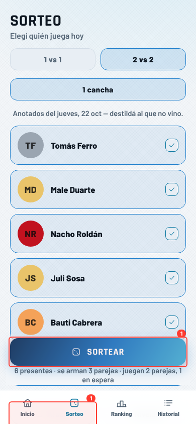
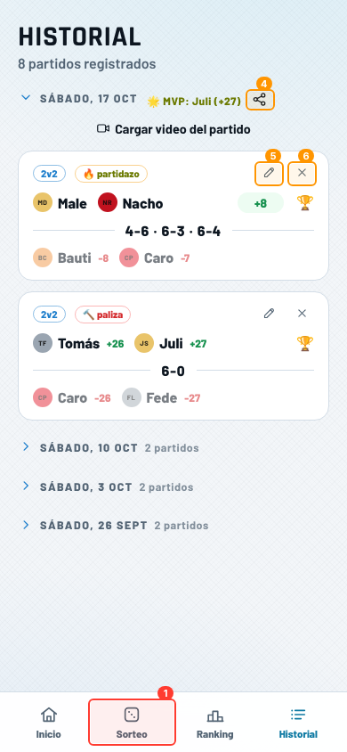

# claude-webapp-qa

Claude Code skills to QA web apps: responsive checks across devices, UX review, Firestore rules tests and one-PR releases.

[Leer en español](README.es.md)


## Skills

| Skill | What it does | Status |
|---|---|---|
| [`responsive-check`](skills/responsive-check/SKILL.md) | Starts your app and walks its screens at 360px, 390px and 1280px, light and dark, with Playwright. Flags horizontal scroll, elements sticking out, cut-off or spilling text, buttons that do not fit; returns annotated screenshots and a prioritized report. | ✅ Ready |
| [`release`](skills/release/SKILL.md) | Batches changes on an accumulation branch, opens a single PR with a summary, follows CI, fixes failures, shares the preview link and warns about cached public images that changed without a rename. | ✅ Ready |
| `firestore-rules` | For every permission change: the rule, a test that must fail and one that must pass, run in the emulator. | 🚧 Planned |
| [`ux-review`](skills/ux-review/SKILL.md) | Checklist review: one meaning per icon (with text), one primary button per moment, protected destructive actions (clicked on demo data to check), clear copy, plus 75 curated UX guidelines. | ✅ Ready |
| `i18n-guard` | Untranslated strings and unused keys. | 🚧 Planned |
| `pre-push` | Lint/test/build, no symlinks or local files committed, no real names in screenshots. | 🚧 Planned |

## Install

In Claude Code:

```
/plugin marketplace add CabralNahuel/claude-webapp-qa
/plugin install webapp-qa@claude-webapp-qa
```

Or copy a skill folder into `~/.claude/skills/` (personal) or `.claude/skills/` (one project).

## responsive-check

Ask in your own words — "check how the app looks on mobile before I ship", "something overflows on /checkout on small phones", "fijate si se ve bien en el celu en modo oscuro". Claude will:

1. Find how to start the app (`npm run dev`) and which routes exist.
2. Find a way in without a real login (demo/sandbox mode, a localStorage key) or use the one you give it.
3. Run [`scripts/responsive_check.mjs`](skills/responsive-check/scripts/responsive_check.mjs) over every route × viewport × theme.
4. Look at the annotated screenshots, discard false alarms, add what the detector cannot see (contrast, covered content) and report worst first, with the likely CSS fix.

<table>
<tr>
<td></td>
<td></td>
<td></td>
</tr>
<tr>
<td>360px, light: low contrast and small tap targets</td>
<td>360px, dark: "▼ -27" runs into the badge</td>
<td>Test fixture with planted bugs</td>
</tr>
</table>


### What it detects

| Severity | Finding |
|---|---|
| critical | The page scrolls horizontally · JavaScript error while loading |
| high | Element sticks out of the viewport · text cut off without ellipsis · text spilling out of a button or heading · content overlapping (a badge running into a pill) |
| medium | Text contrast under WCAG 4.5:1 · text spilling out of other boxes · button label wrapping to 3+ lines · ellipsis on buttons/headings |
| low | Ellipsis on body text · tap target under 24×24px (WCAG 2.5.8) |

The same problem seen at several widths or on every row of a list is reported once.

**What if the content grows?** With `"stress": true` every screen is measured again with texts ~40% longer and three times the chips/tags/avatars, and the report adds a *Fragile under growth* section with what only breaks then. Describe how things should reflow as rules and they get checked too:

```json
"layoutRules": [{ "selector": ".filter-chips", "wrap": true, "align": "center" }]
```

<table>
<tr>
<td></td>
<td></td>
</tr>
<tr><td>Under stress: 3× the chips, rows left-aligned instead of centered</td><td>Under stress: names one word per line, badges broken</td></tr>
</table>


### Running the script yourself

```bash
node skills/responsive-check/scripts/responsive_check.mjs --config qa.config.json
# or
node skills/responsive-check/scripts/responsive_check.mjs \
  --url http://localhost:5173 --start "npm run dev" --routes /,/ranking,/settings \
  --local-storage '{"app.demoUser":{"uid":"demo","demo":true}}'
```

Output: `qa-report/responsive/report.html`, `report.md`, `issues.json` and `screenshots/`. Config reference: [`references/config.md`](skills/responsive-check/references/config.md).

Lessons baked in:

- **Fonts in sandboxes.** Headless browsers often have no network while `curl` goes through the proxy. Without the real web font every measurement is off, so Google Fonts (and any host in `curlHosts`) are fetched with curl and served with `page.route`.
- **Logins.** Most apps have a demo mode; the skill looks for it and sets the localStorage/cookies before the first script runs. Routes that redirect are flagged so you never get a report about the login page.
- **Viewport screenshots, not full-page.** Full-page shots stamp fixed headers and tab bars in the middle of the image. The script scrolls to each problem instead.
- **Dark mode for real.** It emulates `prefers-color-scheme` and, if the app stores a manual choice, writes it too (`themeStorage`).
- **Locale.** Set `locale` to your audience: longer translations are where layouts break.

Requirements: Node 18+ and Playwright (`npm i -D playwright`). It also picks up a global install at `/opt/node-tools/node_modules/playwright` and Chromium at `/opt/pw-browsers/chromium`, as found in Claude Code cloud sessions.

## release

"Ship it", "hacé el release", "abrí el PR": Claude collects the changes on the repo's accumulation branch (e.g. `proximo`, picked up from past merges), so merging is **one deploy per batch instead of one per change**. Then it:

1. runs [`scripts/release_check.mjs`](skills/release/scripts/release_check.mjs): commits grouped by type, a PR body draft, and warnings;
2. runs lint/test/build like CI does, pushes, and opens **one** PR (or updates the open one);
3. follows CI, reads the failing log, reproduces and fixes on the branch until green;
4. hands you the preview link (Firebase channel, Vercel, Netlify, Cloudflare Pages);
5. merges only when you say so, and restarts the branch for the next batch.

The check catches what CI does not:

```
[high] /logo.svg changed but kept its name. Browsers that already have it keep
       showing the old one for up to 30 days. Rename it (e.g. /logo-v2.svg) and
       update every reference.
       cache rule: **/*.@(webp|png|svg|jpg|jpeg|ico) → max-age 2592000s (~30 days)
       ref: index.html:9:
[high] public/favicon-v2.png was renamed to public/favicon-v3.png but
       "favicon-v2.png" is still referenced.
       ref: index.html:5:<link rel="icon" type="image/png" href="/favicon-v2.png" />
       ref: vite.config.js:39:includeAssets: ['favicon-v2.png'],
```

Cache rules are read from `firebase.json`, `vercel.json` or `_headers`; local or generated files in the diff (`.env`, `dist/`) are flagged too.

## ux-review

"Revisá la usabilidad", "¿se entiende la app?": [`scripts/ux_inventory.mjs`](skills/ux-review/scripts/ux_inventory.mjs) collects every control with its icon and label on each screen (phone + desktop) and flags the mechanical cases; Claude then walks the main task end to end and judges the rest against [`references/checklist.md`](skills/ux-review/references/checklist.md):

1. **One meaning per icon, icons with text** — the same drawing used for two actions across the app, icon-only buttons, emoji as the only label.
2. **One primary button per moment** — more than one filled/colored action competing in the same state.
3. **Destructive actions protected** — with `--probe-destructive` (demo data only) it clicks every delete/remove/reset on a fresh load and reports whether the app asked first: browser confirm, dialog, inline "¿Seguro? Sí / No" or undo.
4. **Clear copy** — vague labels, one object with several names, errors and empty states that leave you stuck.

Plus visible keyboard focus, form labels, alt text and headings, and a second pass with 75 guidelines adapted from [ui-ux-pro-max-skill](https://github.com/nextlevelbuilder/ui-ux-pro-max-skill) (MIT).

<table>
<tr>
<td></td>
<td></td>
</tr>
<tr><td>The dice is both the "Draw" tab and the "Random" mode</td><td>Icon-only edit and delete, side by side</td></tr>
</table>

## Repository layout

```
.claude-plugin/        plugin.json + marketplace.json
skills/<name>/         SKILL.md + scripts/ + references/ + templates/
evals/evals.json       test prompts and assertions per skill (skill-creator format)
tools/smoke_test.mjs   validates manifests and skills, runs responsive-check on tools/fixtures
.github/workflows/     CI running the smoke test
```

## Development

```bash
node tools/smoke_test.mjs            # add --browser to require Playwright
```

Skills are written and measured with Anthropic's `skill-creator`: each change is run against the prompts in `evals/evals.json`, with and without the skill, and graded against the assertions.

## License

The UX guidelines in `skills/ux-review/references/guidelines.md` are adapted from [ui-ux-pro-max-skill](https://github.com/nextlevelbuilder/ui-ux-pro-max-skill), MIT License, Copyright (c) 2024 Next Level Builder.

[MIT](LICENSE)
